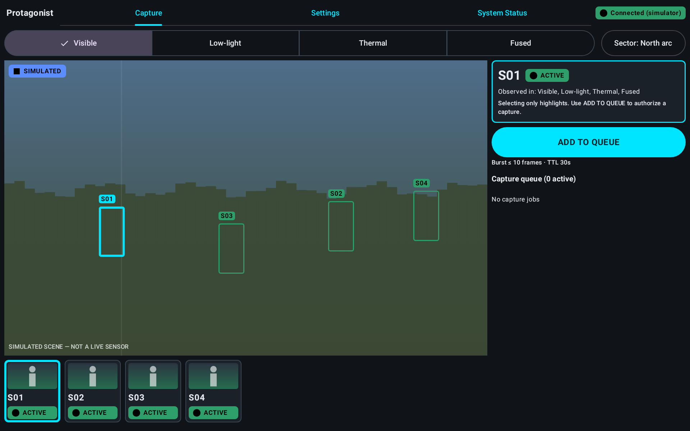
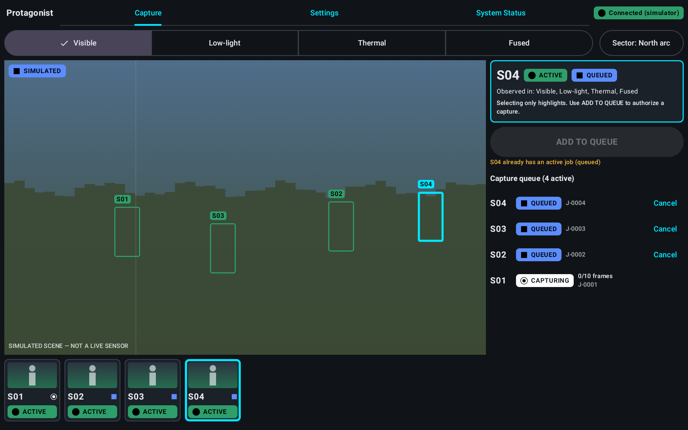
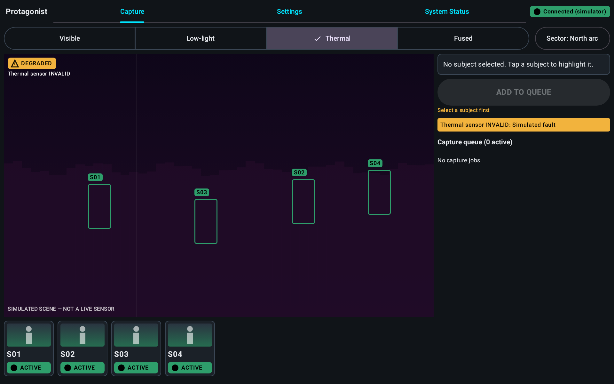
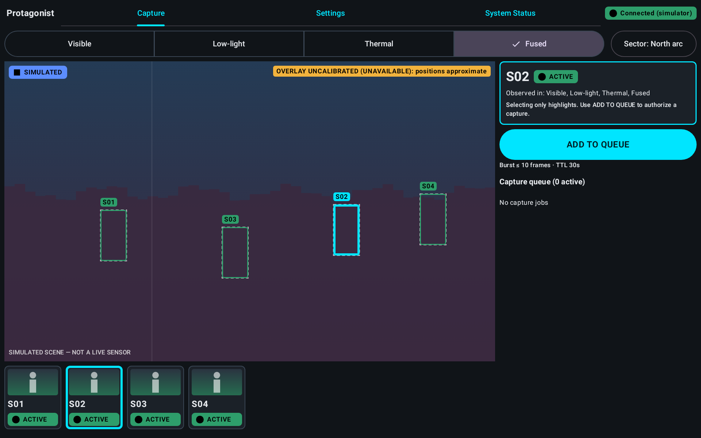
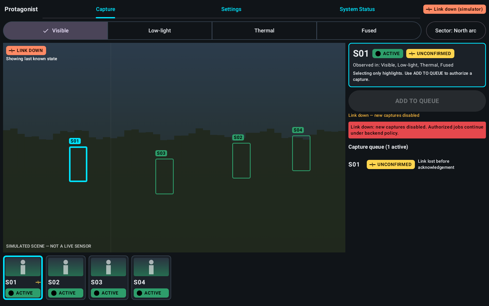
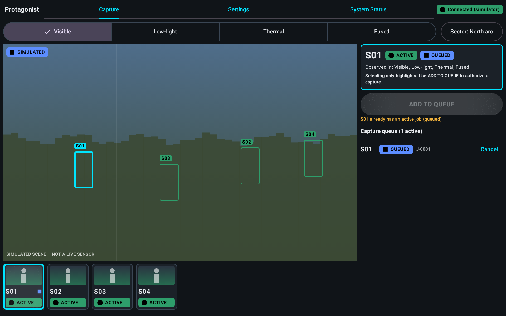
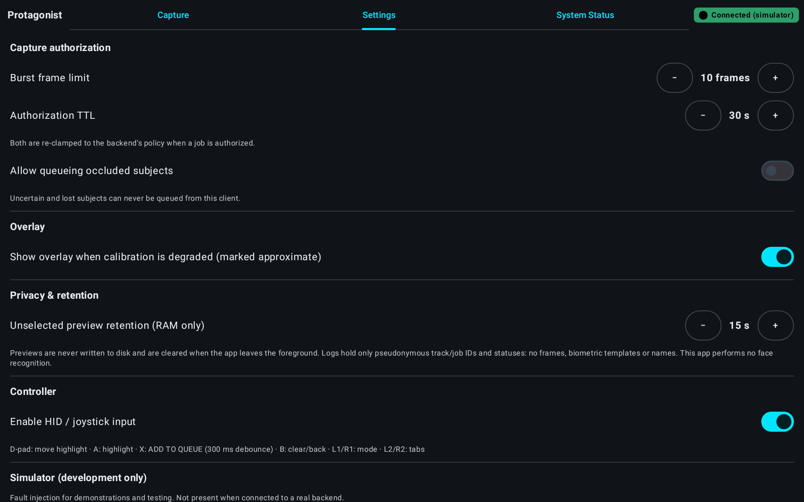
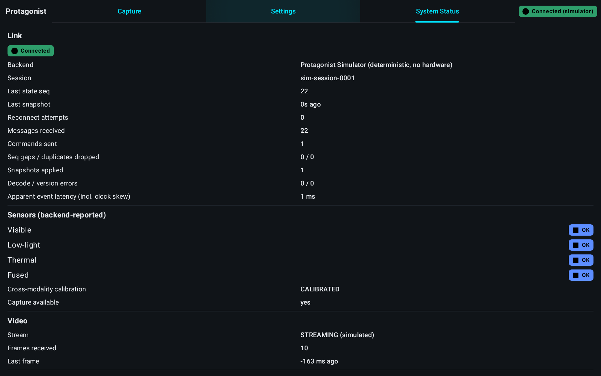
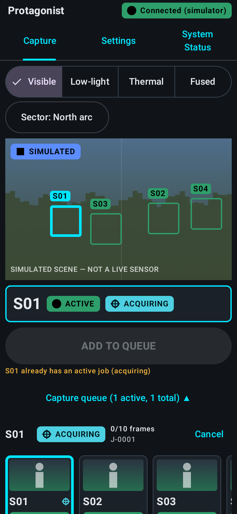
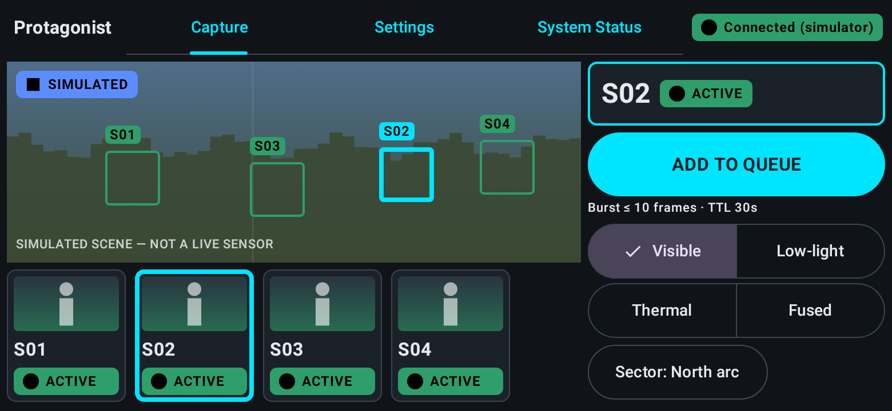

# Protagonist

Android-native operator UI for a single-sector multispectral camera platform. The first milestone runs
end-to-end against a deterministic simulator, with no physical cameras.

| Subsystem | What it is | In this repo |
|---|---|---|
| **Protagonist Control** | The operator app (this Android project): observation view, subject selection, explicit capture authorization, queue, settings, system status. | `:app` and supporting modules |
| **Protagonist Core** | The future vehicle edge service. It owns cameras, tracking, association, camera movement and capture scheduling. Control talks to it over the capture protocol. | **Not here.** Only the client adapter (`:data-remote`) and the wire contract (`contracts/capture_protocol.json`). |
| **Protagonist Simulator** | A deterministic stand-in for Core. It speaks the same protocol, with scripted motion, occlusion, ambiguous reacquisition, delayed acks, link faults and sensor faults. | `:data-sim` |

The product name lives only in identity surfaces: Android resources, Gradle settings, docs and CI labels. Wire
payloads, domain models, adapters and persisted settings are name-neutral (packages `capture.*`), so the core
software doesn't change on a rebrand.

> **Safety and privacy scope.** Protagonist Control performs no face recognition and infers no identity. Track IDs
> such as `S01` are event-local pseudonyms assigned by the backend. Uncertain associations are flagged, never
> merged by the client. Previews are RAM-only with a TTL, and logs carry identifiers and statuses only.

---

## Verification status (read this first)

| What | Status |
|---|---|
| Platform-neutral modules: build, ktlint, 66 unit/integration/acceptance tests | **Run and passing** |
| Android modules: compile, ktlint, Android lint (0 issues in `:app`), debug APK, instrumented-test APK | **Run and passing** |
| Robolectric Compose UI tests: scenarios A, C, F (4 viewports), G, H, branding (8 tests) | **Run and passing** |
| Screenshots of tablet and phone states (`docs/screens/`) | **Rendered** with Robolectric native graphics |
| Instrumented tests on an emulator, screen recording | **Not run**: needs an emulator/device. The `instrumented` CI job runs them on a tablet emulator. |

## Build and test

Requirements: JDK 17+ and Android SDK platform 37 with build-tools (set `ANDROID_HOME` or `local.properties`).
Exact versions are listed in `docs/TOOLCHAIN.md`.

```bash
./gradlew spotlessCheck test assembleDebug
```

The `test` task includes the Robolectric Compose UI tests in `app/src/sharedTest` (scenarios A, C, F, G, H and
branding checks).

To build only the platform-neutral modules (no Android SDK or Google Maven needed):

```bash
./gradlew -Pprotagonist.android=false spotlessCheck test
```

Instrumented Compose tests (the same `sharedTest` sources) on a connected device or emulator:

```bash
./gradlew connectedDebugAndroidTest
```

## Run on an emulator

Create and boot a landscape tablet, the primary target:

```bash
sdkmanager "system-images;android-35;google_apis;x86_64" "emulator" "platform-tools"
```

```bash
avdmanager create avd -n protagonist_tablet -k "system-images;android-35;google_apis;x86_64" -d pixel_tablet
```

```bash
emulator -avd protagonist_tablet
```

Install and launch:

```bash
./gradlew installDebug
```

```bash
adb shell am start -n com.protagonist.app/.MainActivity
```

For the phone layouts use `-d pixel_7` (portrait, and rotate for landscape). The launcher label is **Protagonist**
on both.

The default build uses the simulator. To point at a real Core endpoint, set `CONTROL_URL` in
`app/build.gradle.kts` to a `wss://` URL. Plain `ws://` is rejected. The production video adapter and credential
provisioning are hardware gates (see `docs/HARDWARE_BACKLOG.md`).

## Using the app

* **Capture tab.** A single wide observation view with backend-reported boxes labelled `S01`, `S02`, and so on. Above
  it are the mode toggle (Visible, Low-light, Thermal, Fused) and the sector selector. At the bottom is the
  candidate strip, ordered by first appearance; the order never reshuffles.
  * Tapping a box or a strip card **only highlights** that subject, everywhere at once.
  * **ADD TO QUEUE** is the only touch action that authorizes a capture. A new job shows `PENDING ACK` until the
    backend acknowledges it, then follows the statuses the backend reports: Queued, Acquiring, Capturing, then
    Completed, Failed or Cancelled. Frame counts appear only when the backend reports them.
  * ADD TO QUEUE is disabled, with the reason shown, while the link is down or syncing, when the backend reports
    capture unavailable, for UNCERTAIN or LOST subjects (always) and OCCLUDED subjects (default), and while the
    subject already has an active job.
  * The feed chip shows `SIMULATED` for the simulator. It is never shown as `LIVE`. It shows `DEGRADED` for an
    unhealthy sensor, `NO VIDEO` for stale frames and `LINK DOWN` when offline. A FUSED overlay without
    calibration is labelled *OVERLAY UNCALIBRATED: positions approximate* and drawn with dashed boxes.
* **Settings tab.** Burst frame limit, authorization TTL (both re-clamped to backend policy), occluded-enqueue
  toggle, uncalibrated-overlay toggle, preview retention, and HID enable. A **Simulator** section offers fault
  injection: drop or restore the link, drop the link after the next command, inject a seq gap, sensor and
  calibration faults, forced occlusion, a failed capture, and slow acks.
* **System Status tab.** Link and sync counters (seq, gaps, duplicates, snapshots, decode/version errors),
  backend-reported sensor health and calibration, video stream state, performance telemetry, and build identity.

### Demo timeline (deterministic, sector "North arc")

| t (s) | Event |
|---|---|
| 0 | S01–S04 ACTIVE |
| 20–26 | S01 OCCLUDED ("Occluded by structure"), then ACTIVE with the **same** ID |
| 35 | S03 LOST |
| 40 | S03 UNCERTAIN: ambiguous reacquisition, never auto-merged |
| 45 | S05 appears: a **new** person gets a **new** ID |

Sector "East arc" contains S06 and S07.

### Controller (optional HID / joystick)

| Input | Action |
|---|---|
| D-pad | Move the highlight through subjects in strip order |
| A / D-pad center | Highlight only |
| **X** | **ADD TO QUEUE**. This is the dedicated authorize button, with a 300 ms debounce. |
| B | Clear the selection, or return to Capture from another tab |
| L1 / R1 | Previous / next mode |
| L2 / R2 | Previous / next tab |

Bindings are data (`AndroidHidAdapter.DEFAULT_BINDINGS`). The app remains fully usable by touch.

## Architecture

```
:app ──► :design-system ──► :presentation ──► :domain
  │                              │  ├──► :video
  │                              │  └──► :controller-hid
  ├──► :data-sim ──► :data-remote ──► :domain
  └──► :data-remote (RemoteCaptureRepository: WSS control channel)
```

* `:domain` holds immutable models and the single `CaptureRepository` port. It also holds `EnqueuePolicy` (the one
  definition of when capture may be authorized) and the privacy primitives (`EphemeralPreviewCache`,
  `OperationalLog`).
* `:data-remote` holds the wire DTOs and `ProtocolCodec` (verified against the contract), plus
  `ProtocolCaptureClient`, which implements sequencing, gap/snapshot reconciliation, ack tracking and
  no-replay reconnect. It also holds the `ControlChannel` transports: `InMemoryControlChannel` (mock) and
  `WebSocketControlChannel` (WSS with bearer token), and `RemoteCaptureRepository`.
* `:data-sim` holds `SimulatorServer` (deterministic backend), `LoopbackControlChannel` (link fault injection) and
  `FakeCaptureRepository`. **The simulator runs through the same protocol client as production**, so reconnect and
  reconciliation behave identically in both.
* `:video` holds the `VideoSource` port (frames plus calibration metadata) and `SimulatedVideoSource`. Live video is
  deliberately a separate channel from control/state.
* `:controller-hid` holds `HidCommandMapper`: debounce plus screen- and state-dependent mapping.
* `:presentation` holds `CaptureStateHolder`, a pure `CaptureUiReducer`, operator settings, status design tokens
  (glyph, label and color, contrast-tested) and telemetry. The Android `ViewModel` is a thin wrapper around it.
* `:design-system` holds the brand-neutral Compose theme, `StatusChip` and glyphs.
* `:app` holds the Compose screens, the constructor-injection `AppContainer`, the HID key adapter and the
  launcher identity.

Interfaces and the protocol are documented in `docs/INTERFACES.md`. Release identity is covered in
`docs/RELEASE_IDENTITY.md`, and remaining hardware gates in `docs/HARDWARE_BACKLOG.md`.

## Acceptance scenarios: where they are automated

| | Scenario | Logic level (JVM, full simulator stack) | UI level (Compose) |
|---|---|---|---|
| A | Select highlights everywhere, queue unchanged; Add creates one acked job | `AcceptanceScenariosTest` (A, double tap) | `CaptureUiAcceptanceTest.scenarioA…` |
| B | Rapid S01–S04 creates exactly four jobs; async updates while selecting | `AcceptanceScenariosTest` (B) | — |
| C | Mode switches keep S01; degraded overlay marked | `AcceptanceScenariosTest` (C) | `CaptureUiAcceptanceTest.scenarioC…` |
| D | Occlusion invents no ID; ambiguous reacquisition is UNCERTAIN, not merged | `AcceptanceScenariosTest` (D), `SimulatorServerTest` | — |
| E | Disconnect after command, then reconnect: no duplicate, reconciled by idempotency key | `AcceptanceScenariosTest` (E ×2), `ProtocolCaptureClientTest` | — |
| F | 360dp phone, phone landscape, 7"/12" tablets: reachable, non-overlapping | — | `LayoutAccessibilityTest` |
| G | 48dp targets, labels, contrast, color-blind-distinct statuses | `AccessibilityTokensTest` | `LayoutAccessibilityTest` |
| H | Invalid sensor shows DEGRADED, no live/capture indicator | `AcceptanceScenariosTest` (H ×2) | `CaptureUiAcceptanceTest.scenarioH…` |

## Screen captures

Rendered from the real app against the simulator (Robolectric native graphics). Regenerate with:

```bash
./gradlew :app:testDebugUnitTest --tests '*ScreenshotTest*' -Pprotagonist.screenshots=true
```

| Tablet (1280×800 dp) | |
|---|---|
| S01 highlighted, queue untouched  | S01–S04 authorized rapidly: four distinct jobs  |
| Thermal sensor invalid: DEGRADED, no live indicator  | Fused without calibration: overlay marked approximate  |
| Link lost after command: UNCONFIRMED, enqueue disabled  | Reconnected: reconciled to J-0001, no resend  |
| Settings  | System Status  |

| Phone portrait (360 dp) | Phone landscape |
|---|---|
|  |  |

A screen recording still needs an emulator or device:

```bash
adb shell screenrecord --time-limit 60 /sdcard/protagonist.mp4
```
